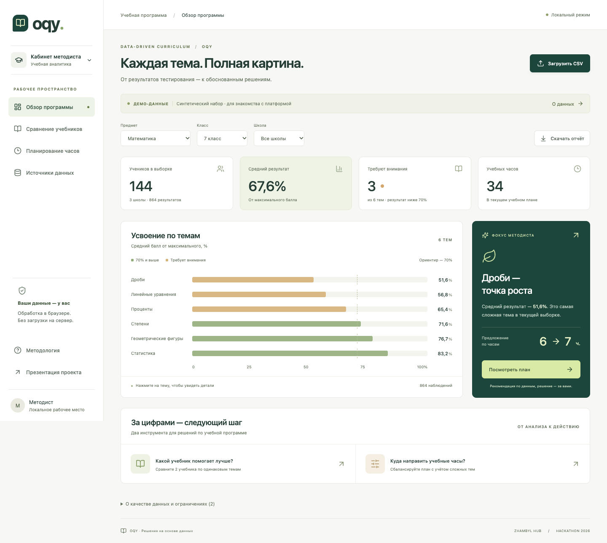
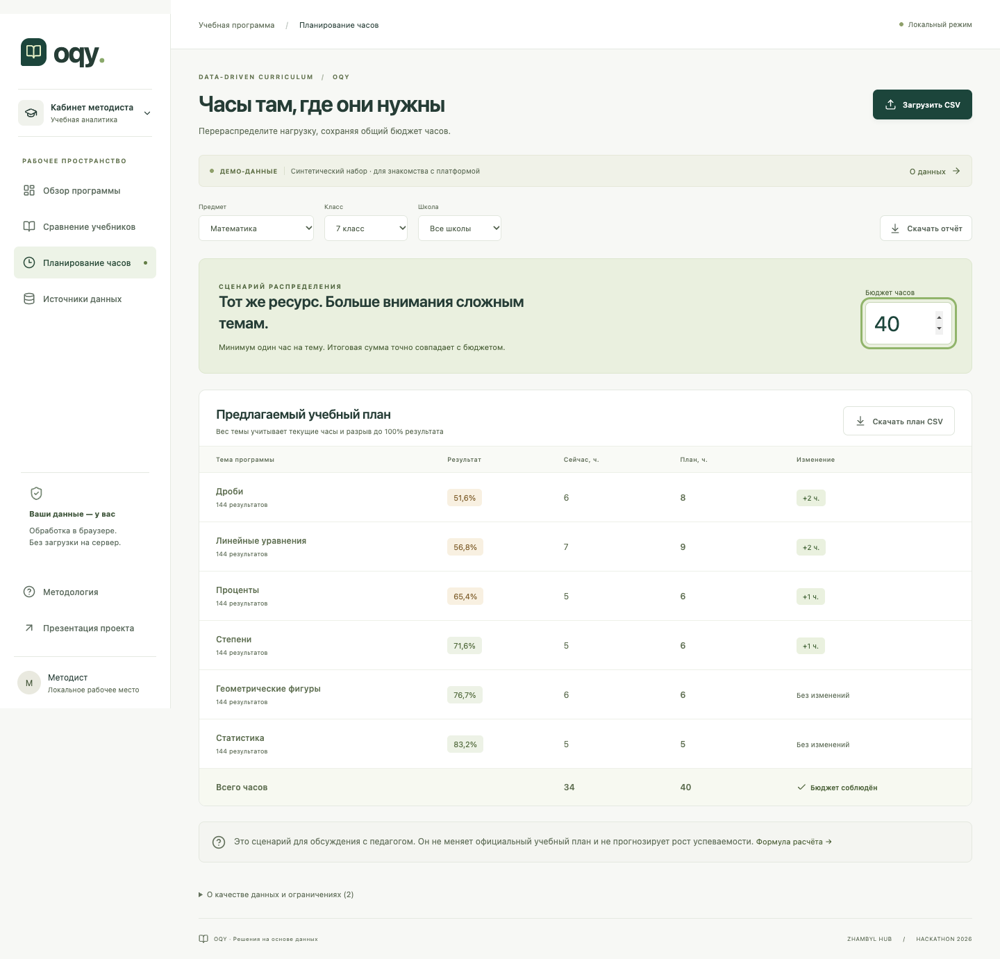

# OQY · Data-Driven Curriculum

**От результатов тестирования к объяснимому плану учебных часов.**

OQY помогает методисту увидеть, какие темы требуют внимания, сопоставить результаты по учебникам и распределить часы в пределах заданного бюджета. Загрузите CSV или Excel `.xlsx`, выберите предмет, класс и школу, затем скачайте план и отчёт. Данные обрабатываются в браузере.

**Zhambyl Hub · Кейс 1**

[**Открыть демо OQY в браузере**](https://nurdaulet362.github.io/oqy-curriculum/)

[Запуск](#быстрый-запуск) · [Демо за минуту](#демо-за-минуту) · [Презентация PDF](artifacts/OQY-pitch.pdf) · [Шаблон Excel](public/data/template.xlsx)

## Быстрый запуск

Из папки проекта с Node.js **22.18+** выполните:

```sh
npm ci
npm run dev
```

Откройте [http://127.0.0.1:5173](http://127.0.0.1:5173) или адрес из терминала. Синтетический набор загружается автоматически. Слайды доступны по `/pitch.html` и как автономный HTML-файл. [Открыть файл слайдов](public/pitch.html)

Если у вас готовый `OQY-demo.zip`, распакуйте его и выполните `python3 start.py` из папки `OQY` (`python start.py` на Windows). Для этого варианта достаточно Python 3. Адрес по умолчанию — [http://127.0.0.1:4173](http://127.0.0.1:4173). Чтобы собрать такой архив из исходников, выполните `npm run package`.

## Демо за минуту

На синтетических данных по математике за 7 класс есть **144 ученика, 864 результата, 6 тем, 3 школы и 2 учебника**.

1. В **«Обзоре программы»** найдите дроби. Их средний результат — **51,6%**. Откройте детали темы, чтобы увидеть объём выборки и разброс результатов.
2. В **«Сравнении учебников»** посмотрите результаты по общим темам. Каждая общая тема имеет одинаковый вес в сравнении.
3. В **«Планировании часов»** раскройте **«Как рассчитано»** у дробей. Текущие 6 часов превращаются в 7 предложенных. В блоке **«Обязательные темы»** задайте дробям минимум **9 часов** и проверьте новый итог.
4. Скачайте полный план в **CSV** или отчёт в **JSON**. В JSON сохранены минимумы, веса и составляющие расчёта по темам.

| Сценарий | План по дробям | Общий бюджет |
| --- | ---: | ---: |
| По умолчанию | 7 ч. | 34 ч. |
| Минимум 9 ч. для дробей | **13 ч.** (9 зарезервировано + 4 из остатка) | **34 ч.** |

[Сохранённый JSON с обоими сценариями](artifacts/demo-report.json) · [CSV исходного плана](artifacts/demo-plan.csv) · [Сценарий защиты на 3 минуты](docs/PITCH.md)



<details>
<summary>Посмотреть экран планирования часов</summary>



</details>

## Свои данные

Одна строка — один результат ученика по теме. Для `student_id` используйте псевдоним, а для `hours` — текущие целые часы по теме. Укажите `score` и `max_score`, чтобы приложение могло сопоставить тесты с разными шкалами. В книге Excel с несколькими листами выберите нужный лист. При ошибке проверки сохраняется предыдущий набор.

Поддерживаются CSV в UTF-8 и Excel `.xlsx` до **5 МиБ** и **20 000 строк данных**. В Excel сохраните формулы как значения, а ID с ведущими нулями — как текст. [Шаблон CSV](public/data/template.csv) · [Шаблон Excel](public/data/template.xlsx) · [Схема колонок и ограничения импорта](docs/DATA.md)

## Как получается план

- **Результаты тем.** Каждый балл приводится к проценту `100 × score / max_score`. OQY показывает среднее, медиану, квартили, стандартное отклонение и распределение баллов. Освоение считается как доля результатов от 70%.
- **Сравнение учебников.** Для каждого учебника вычисляется среднее по общим темам с одинаковым весом каждой темы. На сравнение также могут влиять состав классов, задания и условия обучения.
- **Распределение часов.** OQY сначала резервирует минимум по каждой теме, по умолчанию 1 час. Оставшиеся часы распределяются по весам `текущие часы × (1 + 3 × (100 − средний балл) / 100)` методом наибольших остатков. Если сумма минимумов превышает бюджет, приложение сохраняет последний корректный план.

Поиск и сортировка помогают ориентироваться в таблице. Итог и выгрузка учитывают все темы выбранного набора. План предназначен для обсуждения с методистом. Для оценки педагогического эффекта нужен пилот с сопоставимыми заданиями. [Формулы, допущения и проверка результатов](docs/VALIDATION.md)

## Разработка и проверки

React, TypeScript и Vite. TanStack Table отвечает за поиск и сортировку, Papa Parse и read-excel-file читают файлы, simple-statistics используется для описательных показателей. Excel разбирается в Web Worker. [Расчёты](src/lib/analytics.ts) · [Проверка CSV](src/lib/csv.ts) · [Импорт Excel](src/lib/excel.ts) · [Лицензии зависимостей](public/THIRD-PARTY-NOTICES.txt)

```sh
npm test
npm run build
npm run preview
```

В проверенной сборке прошли **56 unit-тестов и 54 браузерных сценария**. Для повторения браузерной проверки запустите preview, установите Chromium командой `npx playwright install chromium` и в соседнем терминале выполните:

```sh
OQY_BASE_URL=http://127.0.0.1:4173 npm run test:features
```

Для статического хостинга используется `dist/`, который обслуживается по HTTP. Сохранённые результаты сверяются командой `node scripts/generate-evidence.mjs --check`. [Полный список проверок](docs/VALIDATION.md) · [Отчёт браузерных сценариев](artifacts/features-check.json)

## Материалы для защиты

| Материал | Файл |
| --- | --- |
| Шесть слайдов | [PDF](artifacts/OQY-pitch.pdf) · [Автономный HTML](public/pitch.html) |
| Выступление | [Сценарий](docs/PITCH.md) · [Ответы жюри](docs/JURY_QA.md) |
| Кейс и сдача | [Требования кейса](docs/CASE.md) · [Текст для формы](docs/SUBMISSION.md) · [Передача проекта](HANDOFF.md) |
